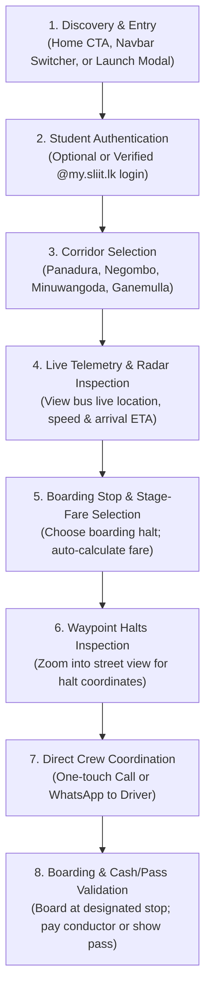

# YATHRA (යාත්‍රා) BUS BOOKING SYSTEM
## Comprehensive Technical & Functional Analysis: Shuttle Mode (SLIIT Campus Transit Hub)

> **Deployment Notice:** This report covers **only** the active **Shuttle Mode** (SLIIT Campus Transit Hub) implementation of the Yathra Mobility platform. All other booking modes are currently in staging / maintenance and have been omitted from this analysis as requested.

---

## 1. Executive Summary

The **Shuttle Mode** within the Yathra (යාත්‍රා) platform is a specialized, production-ready university transit intelligence and GPS radar system built for the **SLIIT Malabe Campus** student community in Sri Lanka. 

While public intercity highway reservations are staged with an announcement lock, **Shuttle Mode is 100% active and operational**, providing:
- Real-time road-snapped GPS telemetry and radar tracking for 4 university shuttle corridors.
- Stage-based fare calculation with intermediate halt detection.
- Live operating window detection (Sri Lanka UTC+5:30 time).
- Direct crew coordination via instant calling and pre-filled WhatsApp messaging.
- Role-gated SLIIT student authentication and pass validation.
- Administrative route studio with Leaflet/Google Roads polyline snapping and GPS hardware webhook receiver.

---

## 2. All Shuttle Mode Related Pages and Routes

### 2.1 Customer-Facing Routes & Pages

| Route | Page / Component | Access Level | Description |
| :--- | :--- | :--- | :--- |
| `/sliit-transit` | `SliitTransitHub.jsx` | Public / Students | **Primary Shuttle Transit Hub**: Live GPS radar map, 4 shuttle corridors, stage-based fare calculator, 4 KPI status cards, interactive waypoint stepper, and driver contact actions. |
| `/login?type=sliit` | `Auth.jsx` (`Login`) | Public | **SLIIT Student Portal Login**: Specialized authentication tab enforcing `@my.sliit.lk` or `@sliit.lk` email domains and student credentials. |
| `/register?type=sliit` | `Auth.jsx` (`Register`) | Public | **SLIIT Student Registration**: Enrolls verified university students with Student ID (e.g. `IT21004567`) and academic email. |
| `/` | `Home.jsx` | Public | **Homepage Gateway**: Hosts the direct "SLIIT Campus Transit Hub 🎓" emerald CTA, Navbar mode switcher, announcement marquee ticker, and the Early Access modal redirection. |

### 2.2 Modal & Global Component Integrations

| Component | Path | Function in Shuttle Mode |
| :--- | :--- | :--- |
| `LaunchAnnouncementBanner.jsx` | `src/components/LaunchAnnouncementBanner.jsx` | Infinite horizontal marquee ticker broadcasted globally across the customer layout promoting the live SLIIT Campus Transit Hub. |
| `PublicBookingNoticeModal.jsx` | `src/components/PublicBookingNoticeModal.jsx` | Luxury Obsidian VIP boarding pass dialog intercepting public booking attempts and guiding users straight to Shuttle Mode via the `"Board Shuttle Now 🎓"` action. |
| `Navbar.jsx` | `src/components/Navbar.jsx` | Features the docked **Premium Mode Switcher** toggling between `Public Travel (Staging)` and `🎓 Campus Mode (LIVE)` with an active green pulse. |
| `SliitCustomRouteMap.jsx` | `src/components/SliitCustomRouteMap.jsx` | Custom Leaflet radar engine embedding road-snapped polylines, numbered waypoint markers, popup modals, and animated bus icon with radar ping. |
| `RouteDrawingStudio.jsx` | `src/components/RouteDrawingStudio.jsx` | Modal-based visual corridor builder enabling admins to click coordinates, snap to Sri Lankan junctions, and calculate distances. |

### 2.3 Administrative Console Routes

| Route | Page / Component | Access Level | Description |
| :--- | :--- | :--- | :--- |
| `/admin/sliit-transit` | `ManageSliitTransit.jsx` | Admin / Operator (or PIN Gate `2026`) | Comprehensive management suite for all 4 shuttle corridors: route CRUD, vehicle specs, driver credentials, stage pricing matrices, operational notices, and virtual GPS simulation controls. |
| `/admin` | `AdminDashboard.jsx` | Admin / Operator | Control center with direct quick-links to Manage Campus Shuttles, customer modal preview, and launch marquee ticker broadcaster. |

### 2.4 Backend REST API Endpoints

| HTTP Method | API Endpoint | Handler File | Functional Purpose |
| :--- | :--- | :--- | :--- |
| `GET` | `/api/campus/shuttles` | `backend/src/routes/api.js` | Retrieves all registered campus shuttles with Sri Lanka time-gating logic (operating windows vs offline state). Supports `forceWindow=true` and admin role bypass. |
| `GET` | `/api/campus/shuttles/:id` | `backend/src/routes/api.js` | Fetches a single shuttle record by its route ID (`sliit-panadura`), bus number, or MongoDB `_id`. |
| `POST` | `/api/campus/shuttles` | `backend/src/routes/api.js` | Admin endpoint to create a new shuttle route with stops and fare stages. |
| `PUT` | `/api/campus/shuttles/:id` | `backend/src/routes/api.js` | Admin endpoint updating timetable, pricing, driver phone, status (`Active`, `Maintenance`, `Inactive`), and urgent delay notices. Synchronizes with `campus_shuttle.json`. |
| `DELETE` | `/api/campus/shuttles/:id` | `backend/src/routes/api.js` | Deletes a shuttle corridor from database and JSON storage. |
| `POST` | `/api/campus/shuttles/:id/simulate` | `backend/src/routes/api.js` | Advances virtual GPS telemetry step along stops (`next`, `reset`, `set`), updating current and next halt. |
| `POST` | `/api/campus/shuttles/seed` | `backend/src/routes/api.js` | Restores default SLIIT shuttle records from `backend/data/campus_shuttle.json`. |
| `POST` | `/api/campus/gps/webhook` | `backend/src/routes/api.js` | Hardware GPS receiver accepting real telemetry pings from SinoTrack, Teltonika, or Coban OBD/tracker devices. |
| `GET` / `PUT` | `/api/settings` | `backend/src/routes/api.js` | Controls platform launch state, ticker message, and admin restriction bypass. |

---

## 3. Homepage and Shuttle Mode UI Design

### 3.1 Homepage Shuttle Integration Architecture

The homepage (`Home.jsx`) is engineered to seamlessly funnel all traffic toward the live Shuttle Mode:
1. **Continuous Marquee Announcement Ticker:**
   - Docked directly below the navigation bar (`LaunchAnnouncementBanner.jsx`).
   - Displays: `ANNOUNCEMENT • SLIIT Campus Transit Hub is now LIVE! Public booking will launching soon... 🎓`.
   - Infinite linear CSS animation (`animate-continuous-marquee`) with edge gradient fade masks.
2. **Hero Section Call-To-Action (CTA):**
   - Alongside the standard search button, the hero features a dedicated Emerald Gradient Button:
     - Title: **SLIIT Campus Transit Hub 🎓**
     - Subtitle: *Live GPS Tracker & Shuttles (Active)*
     - Visuals: Live emerald pulsing dot (`w-2 h-2 rounded-full bg-emerald-300 animate-pulse`), deep emerald shadow (`shadow-emerald-500/20`), and direct instant route transition to `/sliit-transit`.
3. **Navbar Dual-Mode Pill Switcher:**
   - Prominently positioned next to the brand logo.
   - Contains two distinct states:
     - `🚌 Public Travel`: Tagged with an amber `Staging` badge.
     - `🎓 Campus Mode`: Styled with an indigo-blue gradient background, white bold text, pulsing green beacon, and a vibrant `LIVE` badge.
4. **Luxury Obsidian VIP Launch Modal (`PublicBookingNoticeModal.jsx`):**
   - Intercepts any click on "Book Seats Online" or the search form.
   - Renders as a luxury tear-off boarding pass with ambient glowing orbs and laser gradient bar.
   - Informs users that intercity coaches are in readiness staging, whereas SLIIT shuttles are **100% active**.
   - Features a direct high-contrast button: `"Board Shuttle Now 🎓"`.

### 3.2 Shuttle Mode Hub (`SliitTransitHub.jsx`) UI Design

The dedicated Shuttle Hub is styled with an executive **Dark Obsidian & Academic Royal Blue** theme:
1. **Navigation Bar:** "Go Back (ආපසු යන්න)" button paired with a live badge reading: `LIVE v2.5 • Custom Road Engine`.
2. **Hero Header:**
   - Deep navy-to-blue gradient (`from-slate-950 via-blue-950 to-slate-900`) with dual radial light orbs.
   - Badges: `SLIIT Malabe Campus Transit Hub`, `Exclusive Student Fleet`, `Live GPS Telemetry Active`.
   - Title: **SLIIT Shuttle Live GPS Radar**.
   - Bilingual description in Sinhala highlighting authentic road path, live coordinates, fares, and driver contacts.
3. **Shuttle Corridor Grid:**
   - 4 selectable interactive cards displaying corridor code (`PANADURA`, `NEGOMBO`, `MINUWANGODA`, `GANEMULLA`), bus registration number, morning departure time, and fare range (`Rs. 120 - Rs. 180`).
   - Selected card activates an electric blue border, glow ring, and active ping indicator.
4. **SLIIT Student Verification Bar:**
   - Dynamic banner switching based on authentication state:
     - *Verified Student:* Emerald background with checkmark, student full name, email, and validated Student ID.
     - *Guest/Public:* Blue background with link to SLIIT student login/registration.
5. **High-Priority Red Operational Notice Banner:**
   - Automatically appears when vehicle maintenance is flagged or an urgent timetable adjustment occurs.
   - Uses crimson-rose gradients, pulsating `Wrench` or `AlertTriangle` icons, category pills (`🌙 Evening Shuttle`, `📅 Tomorrow Notice`, `🚫 No Service`), and one-touch "Call Driver" button.
6. **Key Details Grid (4 KPI Metric Cards):**
   - **Ticket Fare (ගමන් ගාස්තු):** Displays breakdown of all stages and note indicating direct daily cash payment to conductor.
   - **Driver Contact (රියදුරු):** Displays driver name, mobile number, 1-click `Call Driver` button, and direct `WhatsApp` link.
   - **Timetable (වේලාවන්):** Morning departure, SLIIT arrival ETA, evening return departure, and weekday calendar notice.
   - **Bus Occupancy (ආසන):** Real-time badge (`Seats Available`, `Filling Fast`, `Bus Full`) and seat capacity specifications.
7. **Interactive Live GPS Radar Canvas:**
   - Interactive viewport with top HUD ("Next Halt" indicator, 3 map view toggles, "Bus එක කොහෙද" target button, pause/resume stream toggle, manual step button) and bottom telemetry bar (Speedometer, route name, bus plate, arrival ETA).
8. **Student Stage-Based Fare Calculator & Boarding Selector:**
   - Dropdown halt picker that calculates stage-specific fare instantly with intermediate halt tags.
9. **Sequential Waypoints Stepper:**
   - Numbered grid buttons (#1 to #29) for all stops along the corridor with individual click-to-zoom map inspection.

---

## 4. Shuttle Booking Process from Start to Finish

Because Sri Lankan university campus transit operates on an authentic student commuter model, the booking and onboarding workflow is structured as follows:



### Detailed Walkthrough of Each Step:

1. **Step 1: Access & Entry Point**
   - Passenger arrives via `/sliit-transit`, clicks `"Campus Mode"` in the Navbar, or clicks `"Board Shuttle Now 🎓"` from the launch staging modal.
2. **Step 2: Student Identity Authentication**
   - Passenger can browse as a guest or log in via the SLIIT Student Portal (`/login?type=sliit`).
   - Upon logging in with an `@my.sliit.lk` account, the system validates the Student ID (e.g., `IT21004567`), unlocking verified student status and displaying green authorization badges across all cards.
3. **Step 3: Shuttle Corridor Selection**
   - Passenger selects their desired travel route from the 4 active corridors.
   - The UI immediately recalculates timetables, map routes, waypoints, driver details, and stage fares for that specific vehicle.
4. **Step 4: Live Telemetry & Status Verification**
   - Passenger inspects the live GPS radar canvas:
     - During operating hours (06:00–08:00 AM / 16:00–18:30 PM), the bus displays live motion, current road speed, and next halt ETA.
     - If outside the operating window, the bus indicates its parked status at SLIIT Campus and the next departure time.
     - If the vehicle is in maintenance, the canvas displays a specialized maintenance notice with direct driver contact details.
5. **Step 5: Boarding Halt & Stage Fare Calculation**
   - In the "Student Stage Fares" section, the passenger selects their boarding town from the dropdown (e.g. *Moratuwa*).
   - The calculator instantly matches the halt against the route's stage pricing matrix and updates the Calculated Fare banner:
     - Shows exact single-ride fare (e.g. `Rs. 150`).
     - Highlights the corresponding stage card and intermediate halts.
     - Displays payment instructions: *Direct daily cash payment to bus conductor*.
6. **Step 6: Waypoint Inspection on Map**
   - Passenger clicks on their stop pill in the Waypoints Stepper (e.g. *Stop #7 Katubedda Junction*).
   - The map dynamically zooms in on that exact location, showing the street layout, distance from origin (km), and scheduled arrival offset.
7. **Step 7: Real-Time Crew Coordination**
   - If waiting at the stop, the passenger clicks:
     - **Call Driver:** Directly initiates a voice call to the driver's phone.
     - **WhatsApp Driver:** Opens WhatsApp with a pre-formatted message: `"Hello Driver, I am waiting for the SLIIT Shuttle"`.
8. **Step 8: Physical Boarding & Ticket Validation**
   - Passenger boards the air-conditioned luxury coach at the designated halt.
   - Shows their SLIIT Student ID card and pays the exact stage fare to the conductor, or presents their verified monthly student transit pass.

---

## 5. Available Features and Functionalities

### 5.1 Active Shuttle Corridors

The system maintains 4 fully configured routes in `backend/data/campus_shuttle.json` and `frontend/src/data/sliitTransitData.js`:

| Corridor | Bus Number | Origin | Destination | Morning Dep. | Evening Dep. | Stops | Fare Range | Monthly Pass | Driver & Contact |
| :--- | :--- | :--- | :--- | :--- | :--- | :--- | :--- | :--- | :--- |
| **Panadura ⇄ SLIIT Malabe Shuttle** | `WP NB-5208` | Panadura Bus Stand | SLIIT Malabe Campus | 06:10 AM | 05:40 PM | 29 Stops | Rs. 120 – 180 | Rs. 4,500 | Chaminda Jayalath (`+94 76 688 8078`) |
| **Negombo ⇄ SLIIT Malabe Highway** | `WP NA-9124` | Negombo Bus Stand | SLIIT Malabe Campus | 06:00 AM | 04:45 PM | 9 Stops | Rs. 140 – 280 | Rs. 7,000 | Prasanna Bandara (`+94 71 632 8901`) |
| **Minuwangoda ⇄ SLIIT Malabe Highway** | `WP NB-4410` | Minuwangoda Bus Stand | SLIIT Malabe Campus | 06:10 AM | 04:45 PM | 9 Stops | Rs. 120 – 250 | Rs. 6,200 | Gamini Jayasinghe (`+94 77 554 3210`) |
| **Ganemulla ⇄ SLIIT Malabe Highway** | `WP NC-8831` | Ganemulla Bus Stand | SLIIT Malabe Campus | 06:30 AM | 05:00 PM | 6 Stops | Rs. 90 – 220 | Rs. 5,500 | Ruwan Weerasinghe (`+94 78 123 9876`) |

### 5.2 Live GPS Radar & Map Engines
- **Triple-Engine View Switcher:**
  1. `Google Roads (නියම පාර)`: Uses official Google Maps vector roadmap layer integrated with OSRM (Open Source Routing Machine) driving API to snap polylines to real Sri Lankan streets rather than straight lines.
  2. `Google Satellite (චන්ද්‍රිකා සිතියම)`: High-resolution Google Hybrid Satellite aerial imagery displaying real terrain, road labels, and physical landmarks.
  3. `Google Directions`: Google Maps iframe driving route navigation.
- **Continuous GPS Telemetry Stream:**
  - Automatic background polling every 5 seconds advancing the bus through sequential route coordinates.
  - User zoom lock protection: map does not hijack or reset user manual panning during background location updates.
- **"Bus එක කොහෙද" (Focus Bus) Radar Button:**
  - One-click trigger that executes `map.flyTo()` directly to the live bus coordinates at zoom level 15 and opens the live HUD popup.
- **Interactive Halt Inspection:**
  - Clicking any stop smoothly moves the map viewport and highlights the halt with an amber beacon.

### 5.3 Stage-Based Fare Calculation
- Comprehensive pricing tiers configured for each corridor:
  - *Panadura Route:* Stage 1 (Panadura, Rs. 180), Stage 2 (Moratuwa/Katubedda, Rs. 150), Stage 3 (Dehiwala/Nugegoda/Thalawathugoda, Rs. 120).
  - *Negombo Route:* Stage 1 (Negombo, Rs. 280), Stage 2 (Katunayake E03 Highway, Rs. 220), Stage 3 (Kelaniya/Kaduwela, Rs. 140).
  - *Minuwangoda Route:* Stage 1 (Minuwangoda/Ekala, Rs. 250), Stage 2 (Ja-Ela/Kandana, Rs. 180), Stage 3 (E02 Highway Exit/Kaduwela, Rs. 120).
  - *Ganemulla Route:* Stage 1 (Ganemulla/Ragama, Rs. 220), Stage 2 (Kadawatha Highway Entrance, Rs. 160), Stage 3 (Kaduwela Highway Exit, Rs. 90).
- Automatic stage classification when choosing intermediate towns from the dropdown selector.

### 5.4 Operating Window & Time-Lock Logic
- Built-in Sri Lanka Time Zone converter (`UTC+5:30`):
  - **Morning Operating Window:** 06:00 AM – 08:00 AM (minutes 360 to 480).
  - **Evening Operating Window:** 04:00 PM – 06:30 PM (minutes 960 to 1110).
- When outside the operating window, student views display a parked status and scheduled departure countdown.
- Administrators can toggle `forceWindowActive` to test and simulate telemetry 24/7.

### 5.5 High-Priority Emergency Notice Banner
- Dynamic banner displaying critical service bulletins:
  - Supports Sinhala keywords detection (`හවස` / Evening, `හෙට` / Tomorrow, `නැත` / Cancelled).
  - Shows distinct pills for service disruptions and vehicle maintenance.
  - Provides direct one-click driver phone contact to prevent student stranding at bus halts.

### 5.6 Admin Fleet Management Suite (`ManageSliitTransit.jsx`)
- Complete route lifecycle control: Edit, Add, Delete, and Seed default corridors.
- **Route Drawing Studio (`RouteDrawingStudio.jsx`):**
  - Interactive map studio allowing operators to visually plot waypoints.
  - Automatically matches nearest Sri Lankan junctions using the Haversine formula against `sriLankaJunctions.js`.
  - Calculates cumulative kilometer distance and estimated travel offsets.
- **Virtual Simulator Controller:**
  - Manual step forward, simulation index reset, and custom waypoint jumping.
- **Hardware GPS Webhook Receiver:**
  - Route `/api/campus/gps/webhook` processes real telemetry packets (lat, lng, speed, heading, altitude) matched to vehicle plate numbers.

---

## 6. Important UI Elements and Animations

| UI Element / Feature | Implementation Details | Visual & Animation Effect |
| :--- | :--- | :--- |
| **3D Bilingual Yathra Brand Logo** | `YathraBrandLogo.jsx` / `index.css` | 3D perspective flip (`perspective: 1000px`, `transform-style: preserve-3d`) between English **Yathra** and Sinhala **යාත්‍රා** every 8 seconds (`animate-yathra-3d-flip`), with synchronized session timers across navbar and modals. Features an animated location pin flip (`animate-yathra-pin`) and light sheen sweep (`animate-yathra-sheen`). |
| **Infinite Announcement Marquee** | `LaunchAnnouncementBanner.jsx` / `index.css` | Continuous linear horizontal ticker (`animate-continuous-marquee`, 24s linear loop) with left and right gradient fade masks, displaying the live SLIIT shuttle launch announcement. |
| **Live Pulsing Radar Waves on Bus** | `SliitCustomRouteMap.jsx` | Multi-layered marker with amber bus sphere (`#fbbf24` to `#d97706`), white border, drop shadow, and expanding outer radar wave rings (`animation: ping 2s cubic-bezier(0, 0, 0.2, 1) infinite`). |
| **Luxury Obsidian VIP Boarding Pass** | `PublicBookingNoticeModal.jsx` | Modal dialog styled as a VIP ticket stub with amber-to-crimson glowing laser line (`shadow-[0_0_15px_rgba(239,68,68,0.8)] animate-pulse`), dashed tear-off divider, semicircular cutout notches, and barcode footer. |
| **Emergency Red Operational Banner** | `SliitTransitHub.jsx` | Radiant red-to-rose gradient container (`bg-gradient-to-r from-red-600 via-rose-600 to-red-700`) with animated caution stripe underlay, pulsing `Wrench` or bouncing `AlertTriangle` icon, and pinging indicator. |
| **Maintenance Lockout Display** | `SliitTransitHub.jsx` | Replaces the map canvas during vehicle maintenance with a dark obsidian radar grid, radial rose glow, large animated wrench icon, and direct driver phone action card. |
| **Floating Glassmorphic Map HUD** | `SliitTransitHub.jsx` | Top and bottom map control overlays styled with `backdrop-blur-md`, `bg-slate-900/90`, border `border-slate-700/80`, and glowing text indicators for current speed, halt name, and arrival ETA. |
| **Interactive Waypoint Stepper Buttons** | `SliitTransitHub.jsx` | 29 sequential town badges with badge numbers (#1 to #29). Hovering shifts colors to electric blue; clicking activates an amber/blue ring with scale transition. |

---

## 7. Color Palette, Typography and Branding

### 7.1 Color Palette

```
[ Primary Brand Blue ]   #3b45f5 / #2563eb   (SLIIT Academic Navy & Royal Blue)
[ Accent Cyan / Sky ]    #06b6d4 / #0284c7   (Yathra Mobility Tech Highlights)
[ Obsidian Dark Base ]   #020617 / #0f172a   (Modern Night Surface & Slate)
[ Status Emerald ]       #10b981 / #059669   (Live Active GPS & Verified Student)
[ Alert Amber Gold ]     #f59e0b / #fbbf24   (Fare Stages & Live Radar Marker)
[ Emergency Crimson ]    #ef4444 / #e11d48   (Maintenance Banner & Launch Staging)
```

- **Primary Colors:**
  - SLIIT Academic Royal Blue: `#3b45f5` / `#2563eb` (Used in hero headings, active corridor cards, and primary buttons).
  - Deep Navy / Slate 950: `#020617` / `#0f172a` (Background for map HUD, modals, and card surfaces).
- **Accent Colors:**
  - Mobility Cyan & Sky: `#06b6d4` / `#0284c7` (Road polyline, inspection badges, and sheen beams).
  - Emerald Green: `#10b981` / `#059669` (Live indicators, starting terminal points, verified student badges).
  - Amber & Gold: `#f59e0b` / `#fbbf24` (Live bus radar marker, stage fare chips, VIP badges).
  - Crimson / Rose Red: `#ef4444` / `#f43f5e` (Maintenance alert banner, launch modal border).

### 7.2 Typography

- **Primary Display Font:** `Outfit`, sans-serif (Weights: 600, 700, 800, 900) — Used for headlines, hero titles, corridor names, and modal banners.
- **Body & Interface Font:** `Inter`, sans-serif (Weights: 400, 500, 600) — Used for descriptions, labels, helper text, and alerts.
- **Telemetry & Metric Font:** `ui-monospace`, `SFMono-Regular`, `Menlo`, monospace — Used for bus numbers (e.g., `WP NB-5208`), GPS coordinates, time offsets (`+08m`), and stage indices (`Stage #1`).
- **Trilingual Localization:** Comprehensive bilingual and trilingual copy throughout:
  - English (Primary interface)
  - Sinhala (e.g., `පානදුර ⇄ SLIIT මාලඹේ ශිෂ්‍ය බස් සේවාව`, `සජීවී බස් ධාවන සිතියම`, `දිනපතා බස් රථයේදී කොන්දොස්තරට ගෙවීම`)
  - Tamil (Secondary translation headers)

### 7.3 Brand Identity

- **Platform Brand:** **Yathra (යාත්‍රා) Mobility Sri Lanka**
- **Sub-Brand / Feature Name:** **SLIIT Malabe Campus Transit Hub**
- **Brand Slogan:** *Next-Gen Expressway Transit • අධිවේගී මගී ප්‍රවාහන ජාලය*
- **Visual Identity:** 3D flipping location pin, road-following transit lines, and authenticated student badges.

---

## 8. Best Pages & Scenes to Capture for a Promotional Video

For maximum promotional impact, the following 7 scenes showcase the high-tech, user-centric features of the existing Shuttle Mode:

### Scene 1: Homepage Gateway & Mode Switcher Transition
- **URL:** `/`
- **Focus Area:** Navbar and Hero Section.
- **Action:**
  - Showcase the glowing announcement marquee ticker: *"SLIIT Campus Transit Hub is now LIVE!"*.
  - Show the 3D flipping Yathra logo transitioning smoothly between English and Sinhala.
  - Hover over and click the **"🎓 Campus Mode"** switch on the Navbar with its green pulsing `LIVE` badge, or click the emerald hero CTA: **"SLIIT Campus Transit Hub 🎓"**.

### Scene 2: The Luxury Obsidian VIP Launch Modal
- **URL:** `/` (Triggered by clicking "Book Seats Online" or searching a public route)
- **Focus Area:** `PublicBookingNoticeModal` dialog.
- **Action:**
  - Capture the luxury Obsidian VIP boarding pass appearing with glowing red laser line.
  - Highlight the operational matrix comparing Intercity (Testing) vs Campus Shuttle (100% Boarding Now).
  - Capture the cursor clicking the vibrant **"Board Shuttle Now 🎓"** button to transition directly into the Shuttle Hub.

### Scene 3: SLIIT Transit Hub Hero & 4-Corridor Selection
- **URL:** `/sliit-transit`
- **Focus Area:** Top Hero and Corridor Cards Grid.
- **Action:**
  - Showcase the dark aesthetic hero with glowing orbs and badges (`Live GPS Telemetry Active`).
  - Demonstrate clicking between the 4 active corridors:
    - *Panadura ⇄ SLIIT* (`WP NB-5208`)
    - *Negombo Highway ⇄ SLIIT* (`WP NA-9124`)
    - *Minuwangoda Highway ⇄ SLIIT* (`WP NB-4410`)
    - *Ganemulla Highway ⇄ SLIIT* (`WP NC-8831`)
  - Show the card lighting up with electric blue borders and active status.

### Scene 4: Live GPS Radar Map with 3-Engine Switcher
- **URL:** `/sliit-transit`
- **Focus Area:** Interactive Leaflet Map Canvas.
- **Action:**
  - Capture the amber bus marker moving smoothly along the route with animated pulsing radar waves.
  - Demonstrate switching between **Google Roads (නියම පාර)** and **Google Satellite (චන්ද්‍රිකා සිතියම)** to showcase real aerial imagery.
  - Click the **"🎯 Bus එක කොහෙද"** button to see the camera dynamically fly to the bus location with popup displaying speed, current stop, and driver contact.

### Scene 5: Interactive Stage Fare Calculator & Boarding Selector
- **URL:** `/sliit-transit#fare-stages`
- **Focus Area:** "Student Stage Fares" Section.
- **Action:**
  - Select different boarding stops from the dropdown (e.g. *Panadura* -> `Rs. 180`, *Moratuwa* -> `Rs. 150`, *Dehiwala* -> `Rs. 120`).
  - Show the dynamic "Your Calculated Fare" card instantly updating its pricing and category description.
  - Highlight the intermediate stop tags showing student-friendly clarity.

### Scene 6: Interactive Waypoint Halts Stepper & Direct Driver Actions
- **URL:** `/sliit-transit`
- **Focus Area:** 29-Town Stepper Grid and Driver Contact Card.
- **Action:**
  - Click on sequential halt buttons (e.g., *#7 Katubedda*, *#19 Nugegoda*, *#29 SLIIT*) and show the map zooming directly into that specific junction.
  - Showcase the 1-click **"Call Driver"** and **"WhatsApp Driver"** buttons in the Driver Contact card.

### Scene 7: Admin Route Drawing Studio & GPS Telemetry Simulator
- **URL:** `/admin/sliit-transit` (Accessible via Admin PIN `2026`)
- **Focus Area:** Admin Management Suite and Route Studio modal.
- **Action:**
  - Open the **Route Drawing Studio** to show behind-the-scenes engineering: clicking map points that auto-snap to Sri Lankan junctions and OSRM roads.
  - Click the **"Step Simulation"** button to demonstrate how operators can manually advance the virtual bus along its stops during demonstrations.

---

## 9. Conclusion

The Shuttle Mode of the Yathra Bus Booking System is an exceptionally well-engineered, feature-complete transit tracking and passenger boarding portal. By deliberately scoping the current launch exclusively to the **SLIIT Malabe Campus Transit Hub**, the platform delivers targeted utility with live GPS radar, custom street geometries, stage pricing, and direct crew communication—ready for public promotion and student onboarding.
